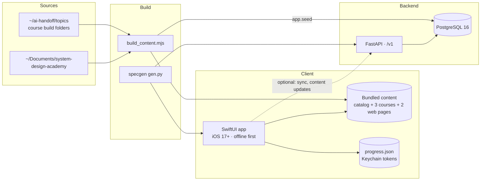
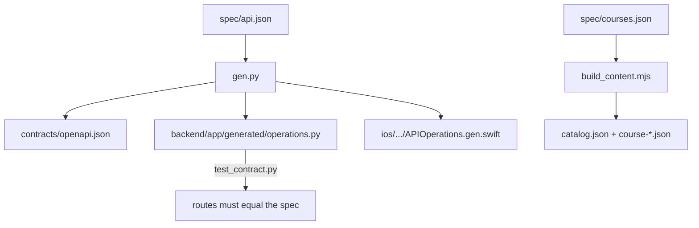
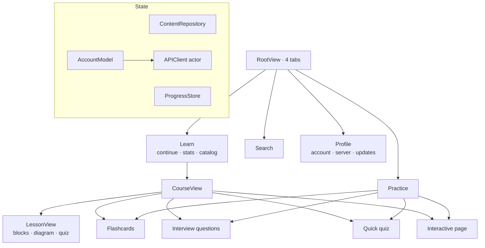
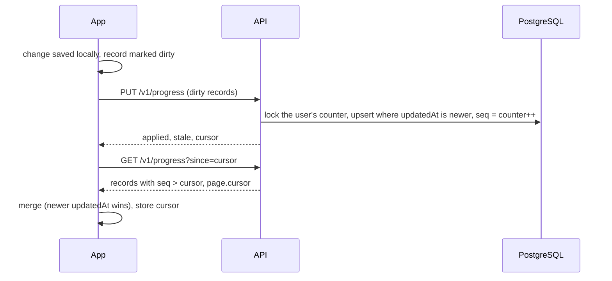

# Mastery Academy — end-to-end architecture

As the code stands on 17 Nov 2026. Parts that are designed but not built are marked **planned**. Diagrams are Mermaid.

## 1. System at a glance

The app is complete without the backend. The backend adds two things: progress on more than one device, and course updates without an app release.

## 2. One spec, everything else derived

`backend/tests/test_contract.py` fails if a route exists without a spec entry, if a spec entry has no route, or if a generated file is stale.

## 3. Content

Every course becomes one JSON document in a block schema (`kb/00-core/04-content-schema.md`): modules → lessons → blocks
(`heading`, `text`, `code`, `list`, `callout`, `table`, `links`, `diagram`), plus quiz questions per lesson and a question bank per course.
The same file is bundled in the app and stored as text in `courses.body`; its `version` is a hash of the content.

| Course | Modules | Lessons | Quiz questions | Q&A |
| --- | --- | --- | --- | --- |
| SwiftUI & iOS Engineering | 22 | 110 | 0 | 191 |
| Swift DSA | 23 | 141 | 108 | 530 |
| System Design | 17 | 49 | 203 | 200 |

Simulators and playgrounds are not rebuilt natively. For SwiftUI and Swift DSA the original page is bundled and shown in a web view;
System Design links to its artifact (its single-file build contains the BigBasket section, which this app excludes).

## 4. App

| Concern | Code |
| --- | --- |
| Navigation: one `Route` enum, ids only | `Core/Models/ProgressModels.swift`, `App/RootView.swift` |
| Content loading, cache override, server refresh | `Core/Data/ContentRepository.swift` |
| Progress, streak, merge rule | `Core/Data/ProgressStore.swift` |
| HTTP, single-flight token refresh, error envelope | `Core/Networking/APIClient.swift` |
| Sign-in and sync loop | `Core/Networking/AccountModel.swift` |
| Inline markup, Swift highlighting | `Core/Text/` |
| Search index | `Core/Search/SearchEngine.swift` |
| Block rendering, diagrams with step player | `Features/Lesson/` |

## 5. Backend

Request path: request-id middleware → rate limit (in process) → bearer check (JWT + live session row) → pydantic validation → handler in one transaction → `{data}` / `{data, page}` / `{error}`.

| Module | Operations | Tables |
| --- | --- | --- |
| auth | registerUser, createSession, refreshSession, deleteSession, getMe, deleteMe | users, sessions |
| content | listCourses, getCourse (ETag) | courses |
| progress | listProgress, pushProgress | progress_records, sync_counters |
| ops | getHealth | — |

Identity: scrypt password hashes; access JWT 15 min carrying user and session ids; opaque refresh token 60 days, stored as SHA-256, rotated on every use; replaying a rotated token ends the session.

## 6. Sync

One record per (user, course, kind, item); kinds are lesson, quiz, card, bookmark. Last write wins by the device's `updatedAt`. The cursor is a per-user sequence, so a pull returns only what changed.

## 7. Deployment shape (target; not provisioned)

One stateless API container behind TLS, managed PostgreSQL with backups. Before running more than one API process, rate limiting moves to a gateway or Redis (`kb/00-core/07-open-decisions.md`, D4).

## 8. Where to go next

State and next steps: `AI_HANDOFF.md`. Course conversion order: `kb/30-execution/checklist.md`.
